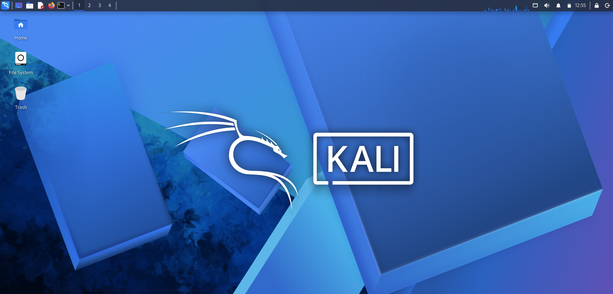
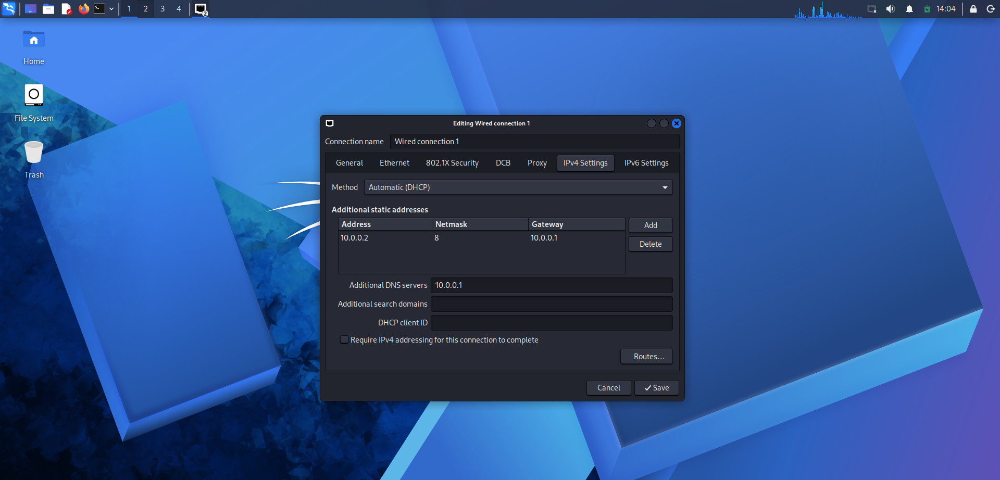

# networkwalks_cybersecurity_lab_setup_B084J_WK01
<div align="center">

#  Cybersecurity Lab Environment Setup

**A Virtual Cybersecurity Lab for Ethical Hacking, Penetration testing & Security Learning**
</div>


---

##  Project Overview

This project focuses on setting up a **virtual cybersecurity laboratory** using Oracle VirtualBox and Kali Linux.

The purpose of the lab is to set up a virtual environment to learn cybersecurity and networking fundamentals.

The lab was configured by installing VirtualBox, setting up Kali Linux as a virtual machine, configuring its IP address, and establishing internet connectivity through a NAT Network.

---


##  Objectives

The main objectives of this project are to:

- Install 7-zip file.
- Install and configure VirtualBox.
- Install/import Kali Linux as a virtual machine.
- Create **NAT NETWORK** on your VirtualBox.
- Configure network connectivity for Kali Linux.
- Assign a consistent IP address to the Kali VM.
- Verify network connectivity and DNS resolution.
- Take a clean VM snapshot for recovery.
- Document the complete setup process.

---

##  Purpose of the Lab

The purpose of this lab is to create a virtual environment using Oracle VirtualBox and Kali Linux. It helps in understanding how virtual machines work and how to configure their network settings. The lab also focuses on setting up an IP address and establishing an internet connection. This environment will be used for learning basic networking and cybersecurity concepts through practical activities.


---

##  Lab Configuration

|    Component     |    Configuration   |
| -----------------| -----------------  |
|  Host OS         | Windows 11         |
|  Processor       | Intel Core i3      |
|  Hypervisor      | VirtualBox 7.2.22  |
|  Security OS     | Kali Linux 2026.3  |
|  Virtual Network | NAT Network        |
|  Network Address | 10.0.0.0/24        |
|  Kali IP Address | 10.0.0.2/24        |
|  Gateway         | 10.0.0.1           |
|  DNS Server      | 10.0.0.1           |


---

# 🪜 Lab Setup Procedure

## Step 1. Install 7-Zip

7-Zip was installed to extract the Kali Linux virtual-machine package, which may be distributed as a `.7z` archive.

---

## Step 2. Install VirtualBox

Oracle VirtualBox was installed to create and manage virtual machines.

---

## Step 3. Create the NAT Network

A dedicated NAT Network was created in VirtualBox.


---

## Step 4. Import Kali Linux

The Kali Linux virtual machine was downloaded from the official Kali Linux website and imported into VirtualBox.




---

## Step 5. Configure the Kali Linux Network

The Kali Linux network configuration was checked and configured with a consistent IPv4 address.



---

## Step 6. Create a Clean VM Snapshot

After completing the initial configuration, a VirtualBox snapshot was created.

Snapshot name:

```text
Kali Linux Setup Snapshot
```


The snapshot represents the clean baseline of the laboratory.

If a future exercise changes or damages the VM configuration, the machine can be restored to this baseline.


---

#  Lab Verification

|  Test                        |  Command                      |   Expected Result              |
| ----------------------------- | -------------------------- | ------------------------------- |
|  Check IP address           | `ip a`                          | Correct IP displayed           |
|  Test gateway               | `ping 10.0.0.1`                 | Successful replies              |
|  Test Internet connectivity | `ping 8.8.8.8`                  | Successful replies              |
|  Test DNS resolution        | `nslookup networkwalks.com`     | Domain resolves                 |
|  Verify Nmap                | `nmap --version`                | Nmap version displayed          |
|  Verify snapshot            | Restore snapshot and run `ip a` | Baseline configuration restored |

### Example Results

```text
IP Address:
10.0.0.2/24

Gateway:
10.0.0.1

DNS:
8.8.8.8
```

---

#  Problems Encountered & Solutions

Documenting problems is an important part of the project.

**Internet Connectivity After Static IP Configuration**

After manually configuring the IPv4 settings, Internet connectivity may fail depending on the Kali/NetworkManager configuration.

One workaround used during this lab was:

```bash
sudo nmcli connection modify "Wired connection 1" ipv4.dad-timeout 0
```

The network connection was then restarted/rebooted and connectivity was tested again.

> **Important:** Network interface and connection names may differ between systems. Students should first identify their actual connection name before running an `nmcli` command.

---


#   What I Learned

- Through this project, I gained practical experience in:

- Installing and configuring Oracle VirtualBox.

- Setting up Kali Linux as a virtual machine.

- Understanding virtualization.

- Configuring NAT Network mode.

- Working with IP addresses and gateways.

- Establishing internet connectivity.

- Using Linux terminal commands for network verification.


#  Tools & Resources

- **7-Zip:** [https://7-zip.org/download.html](https://7-zip.org/download.html)
- **VirtualBox:** [https://virtualbox.org/wiki/Downloads](https://virtualbox.org/wiki/Downloads)
- **Kali Linux:** [https://kali.org/get-kali](https://kali.org/get-kali)

---
# Author
**Uswa Iftikhar**
  Cybersecurity Intern

---

## 📌 Project Information

**Program Name:** Cybersecurity at Networkwalks | **Week:** 01 | **Project:** Cybersecurity & Pentesting Lab Setup | **Repository:** GitHub
